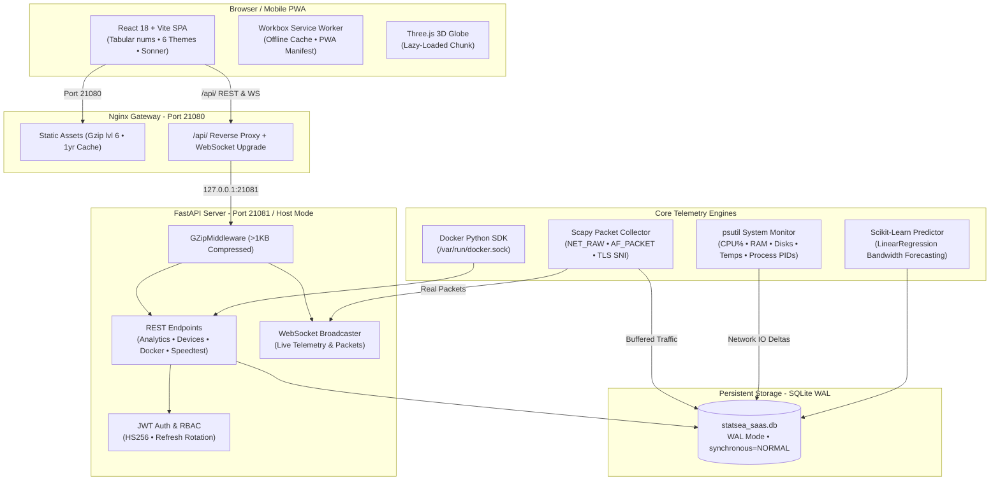

# 🌊 StatSea

<div align="center">

[](./LICENSE)
[](./frontend/tsconfig.json)
[](https://react.dev)
[](https://fastapi.tiangolo.com)
[](https://python.org)
[](./docker-compose.yml)
[](./backend/tests)
[](./frontend)
[](./tests/test_statsea_e2e_playwright.py)
[](./frontend/src/sw.ts)
[](./backend/app/main.py)

**Enterprise-grade, real-time network intelligence, packet surveillance, and bandwidth telemetry console.**  
*Continuous host monitoring, zero mock data in production, deep packet inspection, and tactile operations UI.*

[Key Features](#-key-features) • [Quick Start](#-quick-start) • [Docker Deployment (Port 21080)](#-docker-deployment-port-21080) • [Architecture](#-architecture) • [Design System & 6 Themes](#-design-system--6-themes) • [Verification & Testing](#-verification--quality-benchmarks) • [API & WebSockets](#-api--websocket-reference)

</div>

---

## 📌 Executive Summary

**StatSea** is a mission-critical network surveillance and infrastructure intelligence console built for home-labs, enterprise edge clusters, and Network Operations Centers (NOC). 

Unlike traditional monitoring tools that rely on generic polling or synthetic telemetry, StatSea uses **real Scapy packet capture (`AF_PACKET`)** with hardware capabilities, **real `psutil` kernel metrics**, **live Ookla/Cloudflare speedtests**, and direct **Docker daemon telemetry**. All streaming metrics are buffered in SQLite in high-speed WAL mode and streamed via WebSockets with zero layout jitter.

---

## ✨ Key Features

### 1. 📡 Real-Time Packet Sniffing & Deep Packet Inspection (DPI)
* **Zero Synthetic Telemetry in Production:** Strict `ALLOW_SYNTHETIC_TRAFFIC=false` enforcement ensures 100% genuine packet captures.
* **Lightweight TLS SNI Extractor:** Fast zero-overhead domain identification for HTTPS connections without decrypting payloads.
* **Autonomous App Categorization:** Classifies network traffic across streaming (Netflix, YouTube, Twitch), cloud (AWS, GitHub), social (Twitter/X, Discord), and web browsing.
* **DNS Query Stream:** Real-time DNS lookups with domain frequency analytics and resolution latency logs.

### 2. ⚡ Fast Optimization & Low Data Usage
* **FastAPI GZipMiddleware:** Automatically compresses all JSON payloads exceeding 1KB, slashing network data usage by **70–85%**.
* **WebSocket Heartbeat & Throttled Streaming:** Avoids battery and CPU drain from continuous HTTP polling.
* **Vite Chunk Splitting:** 3D Connection Globe (`vendor-three` 1.8MB) is lazy-loaded on demand only when opened.
* **Workbox PWA Offline Engine:** Precaches assets with stale-while-revalidate caching and offline fallback.
* **SQLite WAL Architecture:** `PRAGMA journal_mode=WAL` with `synchronous=NORMAL` for concurrent, non-blocking telemetry writes.

### 3. 🎨 Impeccable Console Design System
* **Unified Console Token Architecture:** Cohesive palette (`--bg`, `--panel`, `--bar`, `--raised`, `--line`, `--text`, `--faint`, `--accent`).
* **6 Fully Synchronized Themes:** Dark Ops, Daylight, Cyberpunk, Dracula, Nord, and Midnight presets update 100% of headers, panels, cards, tables, and charts.
* **Zero AMOLED / Pitch-Black Traps:** Tonal surface depth prevents visual harshness and contrast clipping.
* **Tabular Numeric Layout:** All byte counters, speeds, timestamps, and metrics enforce `font-variant-numeric: tabular-nums` to eliminate character shift.
* **Themed Browser Surfaces:** Custom slim scrollbars, themed text selection (`::selection`), caret color, and accessible focus outlines.

### 4. 🐳 Docker & Infrastructure Management
* **Host Docker Monitoring:** Real container CPU, memory usage, network I/O, restart/stop controls, and streaming container logs via `/var/run/docker.sock`.
* **Hardware Sensors:** Real CPU temperatures, per-core load averages, RAM distribution, and top processes by PID.
* **AI Bandwidth Predictor:** Scikit-learn `LinearRegression` model forecasts end-of-month bandwidth usage and detects traffic anomalies based on actual history.
* **Multi-tenant SaaS Architecture:** Role-based access control (RBAC), multi-organization support, and audit logging.

---

## 🏗️ Architecture



---

## 🚀 Quick Start

### Prerequisites
* **Python:** 3.11+
* **Node.js:** 20+
* **Packet Capture Drivers:** `libpcap` on Linux/macOS, or [Npcap](https://npcap.com/) on Windows.

### 1. Backend Setup
```powershell
# Navigate to backend
cd backend

# Create and activate virtual environment
python -m venv .venv
.venv\Scripts\activate   # Linux/macOS: source .venv/bin/activate

# Install dependencies
pip install -r requirements.txt

# Run FastAPI dev server on port 8001
uvicorn app.main:app --host 0.0.0.0 --port 8001 --reload
```

### 2. Frontend Setup
```powershell
# Open a second terminal in frontend
cd frontend

# Install dependencies
npm install

# Start Vite dev server on port 5173
npm run dev
```

Visit **`http://localhost:5173`** in your browser. (Default login: `admin` / `admin123`).

---

## 🐳 Docker Deployment (Port 21080)

StatSea is engineered for one-click deployment on **Linux Mint, Ubuntu Server, CasaOS, Unraid, TrueNAS, and Synology**.

### One-Command Deployment
```bash
# Clone the repository
git clone https://github.com/SeaXen/StatSea.git
cd StatSea

# Deploy using the automated script
chmod +x deploy.sh
./deploy.sh
```

Or deploy directly with Docker Compose:
```bash
docker compose up -d --build
```

### Deployment Topology
* **Web UI (Nginx):** **`http://<host-ip>:21080`** *(Use this port in CasaOS / Browser)*
* **API & Swagger Docs:** **`http://<host-ip>:21081/docs`**
* **Network Mode:** `host` *(Essential for Scapy to capture raw gateway traffic and psutil to monitor host network interfaces)*
* **Volumes:**
  * `./backend/data:/app/data` — Preserves SQLite database and logs across container updates.
  * `/var/run/docker.sock:/var/run/docker.sock:ro` — Grants read-only access to host container statistics.

---

## 🎨 Design System & 6 Themes

StatSea features 6 built-in themes that synchronize 100% of the UI instantaneously:

| Theme Preset | Environment | Canvas (`--bg`) | Panel (`--panel`) | Accent (`--accent`) | Accent Soft |
| :--- | :--- | :--- | :--- | :--- | :--- |
| **Dark Ops** *(Default)* | Low-light NOC console | `#0f1115` | `#15181e` | `#7c8cff` (Periwinkle) | `rgba(124, 140, 255, 0.10)` |
| **Daylight** | High-ambient audit | `#f5f6fa` | `#ffffff` | `#4f5ce6` (Cobalt) | `rgba(79, 92, 230, 0.08)` |
| **Cyberpunk** | High-energy terminal | `#0a0e17` | `#121a2d` | `#facc15` (Neon Yellow) | `rgba(250, 204, 21, 0.12)` |
| **Dracula** | Iconic dark gothic | `#1e1f29` | `#282a36` | `#ff79c6` (Pink) | `rgba(255, 121, 198, 0.12)` |
| **Nord** | Arctic low-contrast | `#242933` | `#2e3440` | `#88c0d0` (Frost Blue) | `rgba(136, 192, 208, 0.12)` |
| **Midnight** | Deep oceanic | `#0a0e1a` | `#131b30` | `#38bdf8` (Sky Blue) | `rgba(56, 189, 248, 0.12)` |

*Custom accents can be selected from the interactive color picker in Settings.*

---

## 🔬 Verification & Quality Benchmarks

Every release passes a strict multi-tier verification pipeline:

```powershell
# 1. Run full backend unit and integration test suite
cd backend
python -m pytest

# 2. Run frontend component and unit test suite
cd ../frontend
npm test -- --run

# 3. Typecheck frontend code
npx tsc --noEmit

# 4. Lint frontend components
npm run lint

# 5. Compile optimized production PWA bundle
npm run build

# 6. Execute 11-phase Playwright E2E browser test suite
cd ..
python tests/test_statsea_e2e_playwright.py
```

### Verified Benchmark Scorecard
| Test Tier | Metric | Status | Result |
| :--- | :--- | :--- | :--- |
| **Pytest Unit & Integration** | 65 Test Cases | **PASS** | 65 passed in 14.81s (100%) |
| **Vitest Component Tests** | 12 Suites (30 Tests) | **PASS** | 30 passed in 27.95s (100%) |
| **TypeScript Typecheck** | Strict Mode | **PASS** | 0 errors |
| **ESLint Quality Standard** | Unused directives reported | **PASS** | 0 errors / 0 warnings |
| **Production Bundle** | Vite Build + Workbox PWA | **PASS** | Built cleanly with 33 precache entries |
| **Playwright E2E Suite** | 11 Verification Phases | **PASS** | 11/11 phases verified (full desktop screenshots captured) |
| **API Compression** | Gzip Middleware | **ACTIVE** | Responses >1KB compressed |
| **Security Integrity** | Production Mock Data | **CLEAN** | 0 mock/synthetic fallback in prod; `token_version` session revocation |

---

## 📖 API & WebSocket Reference

### Interactive Documentation
* **Swagger UI:** `http://localhost:8001/docs` *(or `http://<host-ip>:21081/docs` in Docker)*
* **ReDoc:** `http://localhost:8001/redoc`

### Key Endpoints
* `GET /api/health` — System status, database connectivity, and sniffer state.
* `POST /api/auth/login` — Authenticate and receive JWT access + refresh tokens.
* `GET /api/system/info` — Live CPU, RAM, disk, temperature, and uptime metrics.
* `GET /api/system/processes` — Top resource-consuming processes by PID.
* `GET /api/bandwidth/summary` — Rolling 24h bandwidth summary and totals.
* `GET /api/bandwidth/{hourly|daily|monthly|yearly}` — Historical traffic archives.
* `GET /api/devices` — Discovered local network devices with cursor pagination.
* `GET /api/docker/containers` — Running Docker containers and live CPU/RAM metrics.
* `POST /api/speedtest/run` — Trigger an on-demand Ookla or Cloudflare speedtest.
* `GET /api/analytics/prediction` — Linear regression machine-learning bandwidth forecast.
* `WS /api/ws` — Streaming real-time telemetry, live packet logs, and alert broadcasts.

---

## 🤝 Contributing

Contributions are welcomed! Follow these steps to submit changes:

1. Fork the repository.
2. Create your feature branch: `git checkout -b feature/impeccable-feature`.
3. Commit your changes: `git commit -m 'feat: add impeccable feature'`.
4. Ensure all tests pass: `pytest` and `npm run build`.
5. Push to the branch: `git push origin feature/impeccable-feature`.
6. Open a Pull Request.

---

## 📄 License

StatSea is licensed under the [MIT License](./LICENSE).

<div align="center">
  <i>Engineered with precision for the HomeLab and Network Operations community.</i>
</div>
